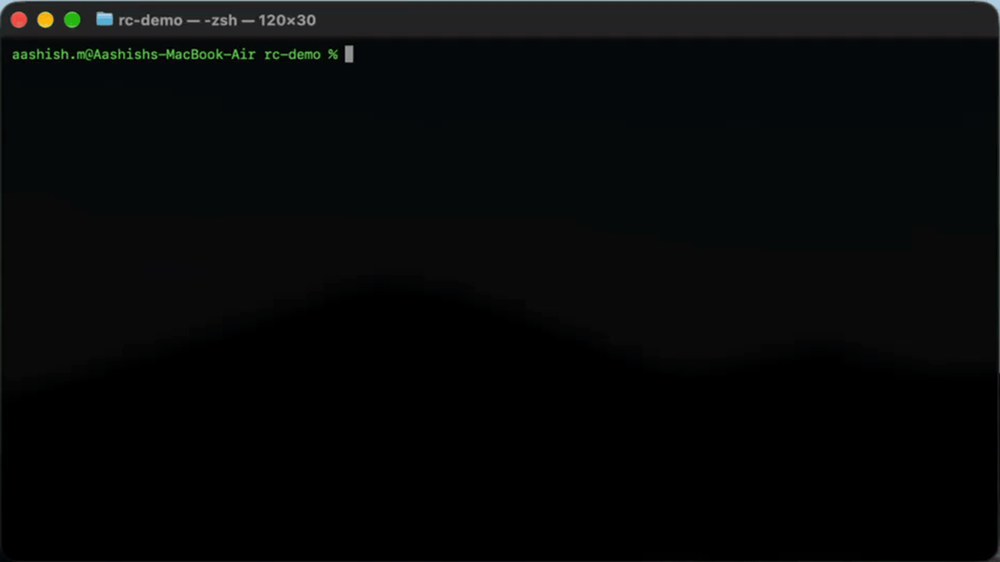

# rulecheck

**Lint your `AGENTS.md`, `CLAUDE.md`, and `.cursorrules`.** Catch stale paths, broken commands, duplicate rules, and conflicting instructions before your AI agent follows them.

```bash
npx rulecheck
```

Your agent reads your rules file on every request. If the file says "components live in `src/old/components/`" and that folder moved six months ago, the agent wastes time or edits the wrong place. Rules files rot, and nothing checks them. Until now.



## Example

```text
$ npx rulecheck

Found 1 rules files. 28 rules, 14 path references, 19 commands.

AGENTS.md
     4  error   Path "src/utlis/" does not exist. Did you mean "src/utils/"?  stale-path
    14  error   Script "test:unitt" not found in package.json. Did you mean "test"?  stale-command
    17  warning Rules recommend both "npm" (AGENTS.md:13) and "pnpm" (AGENTS.md:17).  tool-conflict

3 problems (2 errors, 1 warning)
Score: 76/100 (Good)
```

(Illustrative output.)

## What it checks

| Check | Finds |
|---|---|
| `stale-path` | Files and folders mentioned in your rules that don't exist, with "did you mean" suggestions |
| `stale-command` | `npm run x`, `make x`, and `node file.js` commands that point at missing scripts, targets, or files |
| `duplicate-rule` | Rules that repeat or nearly repeat each other, within a file or across files |
| `tool-conflict` | Rules that recommend two competing tools (npm and pnpm, jest and vitest, tabs and spaces) |
| `opposed-directive` | Rules that contradict each other ("Always use semicolons" vs "Never use semicolons") |
| `token-cost` | Estimated token size of each rules file, since the file is sent with every request |

Files discovered automatically: `AGENTS.md`, `CLAUDE.md`, `.cursorrules`, `.github/copilot-instructions.md`, and `.cursor/rules/*.mdc`, including nested ones.

### Precision over recall

A linter that cries wolf gets uninstalled. rulecheck is deliberately conservative:

- It only reports a missing path when it can be sure. Example rules, placeholders, globs, build output, gitignored files, and "if it exists" mentions are skipped.
- It never runs your commands. It only reads files, so it is safe to run anywhere.
- It runs fully offline, with no API keys and no network calls.

If you hit a false positive, please [open an issue](../../issues). Those are treated as bugs.

## Usage

```bash
npx rulecheck [dir]                 # lint a project (default: current directory)
npx rulecheck --verbose             # also show info-level findings and score breakdown
npx rulecheck --ignore "docs/**"    # skip paths (repeatable)
npx rulecheck --format json         # json | github | markdown | text
npx rulecheck --min-score 80        # fail if the score is below 80
npx rulecheck --max-warnings 5      # fail if there are more than 5 warnings
npx rulecheck --no-color            # plain output (NO_COLOR is also respected)
```

Run `npx rulecheck --help` for the full list.

### Exit codes

| Code | Meaning |
|---|---|
| `0` | No errors, and all thresholds passed |
| `1` | At least one error, or a threshold failed |
| `2` | Tool failure (bad directory, invalid option) |

## Score

Every project gets a score from 0 to 100.

- Start at 100. Each **error** costs 10 points and each **warning** costs 4. Info costs nothing.
- One check can cost at most 40 points, so a single noisy rule can't zero your score alone.
- When several findings share one line, only the worst one counts.

| Score | Grade |
|---|---|
| 90 to 100 | Excellent |
| 75 to 89 | Good |
| 50 to 74 | Needs work |
| 0 to 49 | Poor |

## GitHub Action

Findings show up as inline annotations on your pull requests, plus a summary on the run page.

```yaml
name: rulecheck
on: [pull_request]

jobs:
  rulecheck:
    runs-on: ubuntu-latest
    permissions:
      contents: read
    steps:
      - uses: actions/checkout@v4
      - uses: aashish1876/rulecheck@v0
        with:
          min-score: 80
```

| Input | Default | Description |
|---|---|---|
| `path` | `.` | Directory to check |
| `ignore` | | Comma-separated globs to skip |
| `min-score` | | Fail if the score is lower |
| `max-warnings` | | Fail if there are more warnings |
| `verbose` | `false` | Include info-level findings |

Output: `score`, the 0 to 100 score (empty if no rules files were found).

## Badge

```bash
npx rulecheck badge
```

This writes `rulecheck-badge.svg` and prints the Markdown to paste into your README:

```markdown

```

Re-run it in CI to keep the badge current.

## Tested on real projects

rulecheck was run against the rules files of ten popular open-source projects, including Next.js, LangChain, n8n, Grafana, Deno, and Codex, and tuned until its false positives were gone. It also found real problems. For example, one project's `AGENTS.md` sends agents to a components folder that no longer exists.

## Limitations

- Token counts are estimates (characters divided by 4), not exact tokenizer output.
- Contradiction detection is heuristic and intentionally misses subtle conflicts.
- It checks structure and references, not whether your rules are *good* advice.

## Contributing

Issues and pull requests are welcome. The most useful contribution is a real-world rules file that produces a wrong finding. Add it as a fixture in `tests/fixtures` along with a failing test.

```bash
npm install
npm run build
npm test
```

## License

MIT
